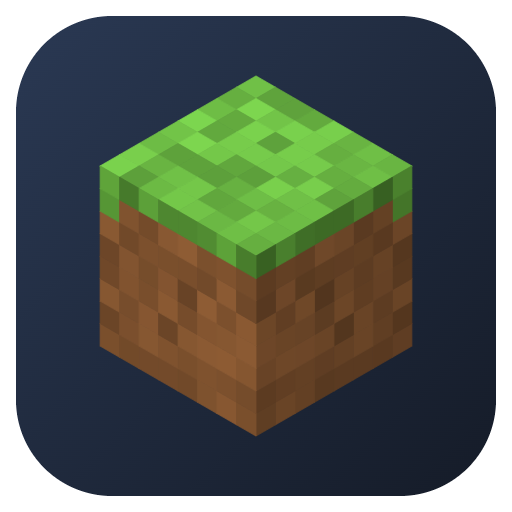
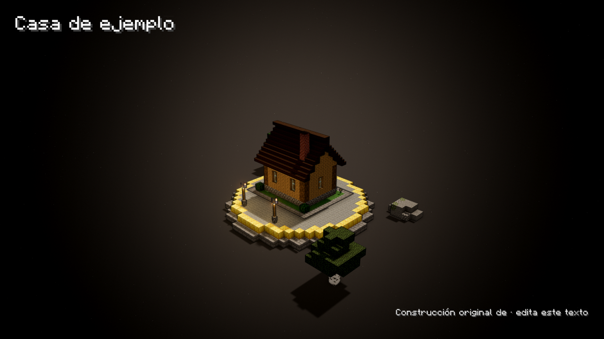
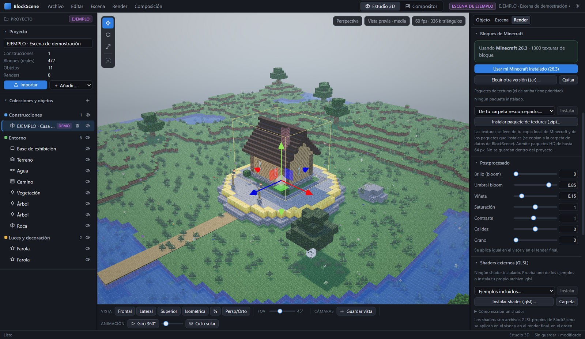
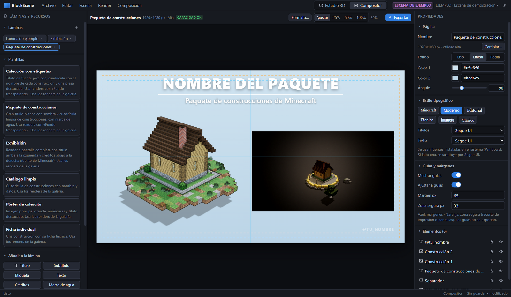

<p align="center"></p>

# BlockScene

Aplicación de escritorio gratuita para crear **escenas 3D y láminas de presentación** a partir de construcciones de Minecraft.

<p align="center">
  <a href="https://github.com/anthonylol12/BlockScene/releases/latest"><b>⬇️ Descargar para Windows</b></a> ·
  <a href="https://github.com/anthonylol12/BlockScene/wiki"><b>📖 Wiki</b></a> ·
  <a href="https://github.com/anthonylol12/BlockScene/releases/latest"><b>📘 Guía en PDF</b></a>
</p>



- **Estudio 3D**: importa varias construcciones (`.schem`, `.litematic`, `.nbt`, `.schematic`, `.mca`) y organízalas en una escena con entorno de bloques: terreno, agua, árboles, islas de terreno, bases de exhibición… Usa las texturas de tu Minecraft y tus paquetes de texturas, aplica estilos visuales y shaders GLSL, y genera renders.
- **Compositor**: diseña láminas con varios renders, textos (también con la fuente de Minecraft) y plantillas, y expórtalas en PNG o JPG.

| Estudio 3D | Compositor |
|---|---|
|  |  |

> **Cómo usarlo:** consulta la [wiki](https://github.com/anthonylol12/BlockScene/wiki) o descarga la guía en PDF (`BlockScene-Guia.pdf`) desde [Releases](https://github.com/anthonylol12/BlockScene/releases/latest). Las páginas de la wiki están en [`docs/wiki`](docs/wiki) y la guía se genera con `npx electron scripts/make-guide.cjs`.

## Empezar

Abre la app y pulsa **Crear escena paso a paso** (o **Ctrl+Mayús+N**). El asistente te guía por los pasos:

1. importar la construcción, con una vista previa de sus datos;
2. elegir texturas;
3. crear una base ajustada a su tamaño;
4. escoger un estilo, viendo qué cambia;
5. renderizar.

Al final se abre la lámina lista en el Compositor. Después de cualquier render, **Añadir a lámina** hace lo mismo con la plantilla que elijas.

## Requisitos

- Windows 10/11 (también debería funcionar en macOS/Linux, pero no se ha probado).
- Node.js 20 o superior (probado con Node 26).
- GPU con WebGL2 y la aceleración por hardware activada.
- Opcional: **Minecraft Java Edition** instalado, para usar las texturas reales de los bloques.

## Instalar (usuarios)

Ejecuta `BlockScene-Setup-0.1.0.exe` (carpeta `dist/` tras compilarlo; ver abajo). El instalador:

- deja elegir la carpeta de instalación (por usuario, sin permisos de administrador);
- crea accesos directos en el menú Inicio y el escritorio, y un desinstalador en *Configuración → Aplicaciones*;
- asocia los archivos `.bscene`: con doble clic se abren en BlockScene (si ya está abierta, se usa la misma ventana).

El instalador **no está firmado digitalmente**, así que Windows SmartScreen puede mostrar «Windows protegió su PC». Pulsa *Más información → Ejecutar de todas formas*. Para evitarlo hace falta un certificado de firma de código.

### Crear el instalador

```bash
npm run dist
```

Genera `dist/BlockScene-Setup-<versión>.exe` con electron-builder (NSIS). `dist/win-unpacked/` contiene la versión sin instalar. NSIS no admite rutas de más de 260 caracteres; si la carpeta del proyecto es muy larga, `scripts/dist.cjs` la monta temporalmente en una unidad virtual (`subst`) y la desmonta al terminar. El icono está en `build/` y se regenera con `npm run icon`.

Para comprobar la app empaquetada (abre la ventana, verifica el visor y guarda una captura):

```bash
node scripts/check-packaged.cjs dist/win-unpacked/BlockScene.exe captura.png [proyecto.bscene]
```

## Desarrollo

```bash
npm install
npm run dev
```

`npm install` descarga Electron. Si la carpeta `node_modules/electron/dist` no aparece, ejecuta `node node_modules/electron/install.js`.

Otros comandos:

| Comando | Qué hace |
|---|---|
| `npm run dev` | Arranca la app en modo desarrollo (recarga en caliente). |
| `npm run build` | Compila main, preload y renderer en `out/`. |
| `npm start` | Ejecuta la versión compilada. |
| `npm run typecheck` | Comprobación de tipos de TypeScript. |
| `npm test` | Pruebas unitarias (formatos, NBT, malla, texturas, formas). |
| `npm run dist` | Crea el instalador de Windows en `dist/`. |
| `npm run icon` | Regenera el icono de la aplicación. |

Prueba de extremo a extremo (tras `npm run build`; usa la app real con diálogos simulados):

```bash
set BS_FIXTURES=%TEMP%\bs-fixtures && npx vitest run tests/gen-fixtures.test.ts
npx electron scripts/e2e.cjs %TEMP%\bs-fixtures %TEMP%\bs-e2e
```

## Texturas de los bloques de Minecraft

Las texturas de Minecraft pertenecen a Mojang y **no se incluyen** en BlockScene. La app las lee de **tu propia copia**:

1. Estudio 3D → panel derecho → pestaña **Render** → sección **Bloques de Minecraft**.
2. **Usar mi Minecraft instalado** detecta la versión más reciente en `%APPDATA%\.minecraft\versions`.
3. O bien **Elegir .jar o paquete .zip…** para usar otra versión o un paquete de recursos.

Las texturas no se guardan dentro de los proyectos `.bscene`. La app recuerda la fuente elegida y la vuelve a cargar al iniciarse. Sin texturas, cada bloque se dibuja con una textura pixelada genérica y su color aproximado.

### Paquetes de texturas (resource packs)

En la misma sección, **Paquetes de texturas**:

- **Instalar paquete de texturas (.zip)…**, o elige uno de tu carpeta `.minecraft/resourcepacks` en la lista desplegable.
- El paquete se copia a la carpeta de datos de BlockScene, así que sigue funcionando aunque lo borres de Minecraft.
- Se aplica **por encima** de la versión base, como en el juego. Los bloques que el paquete no cambia usan la textura vanilla.
- Se pueden activar o desactivar, ordenar (el de arriba tiene prioridad) y desinstalar.
- Admite paquetes HD de hasta 64 px; los de mayor resolución se reducen a 64 px.
- Del paquete solo se usan las texturas de bloque (`assets/minecraft/textures/block`) y la fuente. Se ignoran los modelos, los efectos de OptiFine (texturas conectadas, CIT…) y los *core shaders*.

## Estilos visuales ("shaders")

Pestaña **Render → Estilo visual**. Un estilo aplica en un clic la iluminación, el fondo, las nubes, la niebla y el postprocesado. Incluidos:

- **Exhibición oscura**: fondo de estudio oscuro con motas, sombra suave en el suelo, brillo en las luces, viñeta y grano. Es el aspecto típico de las presentaciones de construcciones.
- Estudio claro, Mundo natural, Atardecer cinematográfico, Noche con faroles, Mañana con niebla y Vibrante.
- **Estilos de renders de internet**: recrean los aspectos más habituales en las presentaciones de construcciones publicadas en redes y Patreon.
  - **Colección pergamino**: fondo beige liso, como las hojas de colección.
  - **Paquete pastel**: fondo azul pastel y sombras cortas, como los paquetes de casas.
  - **Noche cinematográfica**: ventanas y faroles brillando, viñeta fuerte; combínalo con el shader Profundidad de campo.
  - **Hora dorada**: paisaje al estilo Chunky o Blender.
  - **Plano técnico**: fondo azul y luz plana, para guías de construcción.
  - **Miniatura**: estilo tilt-shift, con el shader Profundidad de campo.
  - **Invierno**: nieve, luz fría y niebla blanca.

### Recetas para presentaciones como las de internet

| Aspecto | Base de la construcción | Estilo | Render | Plantilla |
|---|---|---|---|---|
| Hoja de colección | Isla de terreno (seco) | Colección pergamino | Fondo transparente | Colección con etiquetas |
| Paquete de casas | Isla de terreno (verde) | Paquete pastel | Fondo transparente | Paquete de construcciones |
| Pieza destacada oscura | Escalonada o isla | Exhibición oscura | Normal | Exhibición |
| Escena nocturna | Terreno + agua | Noche cinematográfica + shader Profundidad de campo | Normal | Exhibición |

- La base **Isla de terreno** es una porción de terreno orgánica e irregular bajo la construcción, con hierba y flores en el borde. Puede ser verde, seca, nevada o de arena.
- Los renders con **fondo transparente** se recortan solos al contenido y conservan la sombra del suelo. Así, en las plantillas las construcciones aparecen recortadas sobre el fondo de la lámina.

**Instalar estilo…** carga archivos `.bslook`. **Exportar actual…** guarda los ajustes actuales como `.bslook` para compartirlos o reutilizarlos.

**Los shaderpacks de OptiFine/Iris no son compatibles.** Son programas GLSL escritos para el motor de Minecraft (sus búferes, pasadas y variables), que BlockScene no tiene. Si eliges uno, la app lo detecta y lo explica. El equivalente en BlockScene son los estilos y el postprocesado:

- **Fondo** (pestaña Escena): *Cielo y mundo* o *Estudio de exhibición*, con degradado, motas de polvo, suelo invisible que solo recibe la sombra y opción de ocultar el terreno, el agua, los caminos y la vegetación.
- **Postprocesado** (pestaña Render): brillo (bloom) y su umbral, viñeta, saturación, contraste, calidez y grano. Se aplica igual en el visor y en el render final, junto con la oclusión ambiental GTAO.

## Shaders externos (GLSL)

Pestaña **Render → Shaders externos**. Son archivos `.glsl` propios de BlockScene que se añaden como pasadas de postprocesado, en el visor y en el render final, en el orden de la lista. Al instalarlos se copian a la carpeta de datos de la app; el botón **Carpeta** la abre.

- **Ejemplos incluidos**: contorno cel, profundidad de campo, aberración cromática, cine teal y naranja, y nitidez. Sirven también de plantilla para escribir los tuyos.
- Cada shader se activa o desactiva y se ordena. Sus parámetros aparecen como deslizadores al desplegarlo.
- Si un shader no compila, se muestra el error de GLSL con su línea y se omite, sin romper el render.

Formato:

```glsl
// @name Mi efecto
// @description Texto de ayuda
// @stage ldr          // ldr: después del tono (sRGB) · hdr: antes (lineal)
// @depth              // opcional: activa la textura de profundidad tDepth
// @param fuerza 0.5 0 1 Fuerza   // nombre  defecto  mín  máx  etiqueta
uniform sampler2D tDiffuse;   // imagen
uniform sampler2D tDepth;     // profundidad 0..1 (con @depth)
uniform vec2 uResolution;     // píxeles
uniform float uTime, uNear, uFar;
uniform float fuerza;         // cada @param es un uniform float
varying vec2 vUv;
void main() { gl_FragColor = texture2D(tDiffuse, vUv); }
```

Los shaderpacks de OptiFine/Iris siguen sin ser compatibles. Si arrastras uno, la app lo detecta y lo explica.

## Instalar arrastrando

Suelta archivos en cualquier parte de la ventana:

| Archivo | Qué hace |
|---|---|
| `.schem` `.schematic` `.litematic` `.nbt` `.mca` | Importa la construcción |
| `.zip` | Instala el paquete de texturas (o avisa si es un shaderpack) |
| `.glsl` `.frag` | Instala el shader externo |
| `.bslook` | Instala y aplica el estilo visual |
| `.png` `.jpg` `.webp` | Añade la imagen a la galería del Compositor |

## Preferencias y valores por defecto

**Editar → Preferencias…** (`Ctrl+,`) o el engranaje de la barra superior:

- **Ratón**: BlockScene (izquierdo orbita, derecho desplaza), estilo Blender (rueda pulsada orbita, Mayús + rueda desplaza) o panel táctil. También velocidades de órbita, zoom y desplazamiento, zoom invertido y cámara suave.
- **Herramientas**: la herramienta inicial (mover, girar o escalar) y los ajustes del gizmo. Por defecto se mueve **de bloque en bloque** y se gira cada 15°. También el tamaño del gizmo.
- **Restablecer valores por defecto**: controles y herramientas, escena y render del proyecto, diseño de paneles, o todo a la vez. No toca construcciones, renders ni láminas.

## Texto sobre el render

El render final sale **sin texto**. Los textos se añaden después, en el **Compositor**:

1. Haz el render en el Estudio 3D (F12).
2. En el Compositor elige la plantilla **Exhibición**: el render a pantalla completa, el título arriba a la izquierda y los créditos abajo a la derecha.
3. Edita los textos y exporta en PNG o JPG.

La fuente **Minecraft (de tu juego)** se lee de tu copia de Minecraft (`textures/font`, con acentos y caracteres latinos) y se dibuja píxel a píxel con la sombra del juego. Está disponible cuando has cargado las texturas de tu instalación. También puedes elegirla en cualquier texto o en el estilo tipográfico «Minecraft».

## Formatos compatibles

| Extensión | Formato | Estado |
|---|---|---|
| `.schem` | Sponge Schematic v1, v2 y v3 (WorldEdit 7+, FAWE) | Completo |
| `.litematic` | Litematica (varias regiones, se combinan) | Completo |
| `.nbt` | Estructura de Minecraft (Structure Block) | Completo; si hay varias paletas, se usa la primera |
| `.schematic` | MCEdit / WorldEdit clásico (IDs pre-1.13) | Parcial: se traducen los bloques más comunes; el resto se marca como desconocido |
| `.mca` | Región de mundo Anvil (Java 1.13+) | Parcial: se recorta al contenido; los chunks LZ4 se omiten |

- El formato se detecta por el **contenido**, no solo por la extensión. gzip y zlib se descomprimen automáticamente.
- Los datos que se muestran (formato, versión, dimensiones, número de bloques, autor) se leen del archivo. Si un dato no está en el archivo, no se muestra.
- Límites: 120 millones de vóxeles por construcción, 16 millones de caras visibles y archivos de hasta 512 MB.
- **No compatible**: mundos completos (carpetas), Bedrock (`.mcstructure`), `.mcr`, entidades, contenido de cofres y carteles, biomas.

## Qué funciona

**Estudio 3D**
- Importación múltiple (botón o arrastrar y soltar), análisis en un Web Worker sin bloquear la interfaz, informe con los datos reales del archivo y errores comprensibles.
- Colecciones (capas), mostrar/ocultar, seleccionar, quitar, renombrar.
- Mover, girar y escalar con gizmo o con valores numéricos; duplicar; deshacer/rehacer.
- Cámara: órbita, zoom y desplazamiento; vistas frontal, lateral, superior, isométrica (ortográfica), ¾ y perspectiva; FOV; vistas guardadas y cámara principal.
- Animación: giro de 360° de la cámara y ciclo solar.
- Elementos de escena hechos de bloques: base de exhibición, terreno (con hierba, flores y árboles), agua, caminos, rocas, árboles (9 especies), vegetación, luces y decoración (farola, valla, banco, hoguera, pozo, barril).
- Ambiente: hora del día, orientación, color e intensidad del sol, sombras con suavidad, luz ambiental, exposición; cielo con sol cuadrado y estrellas; nubes de bloques o volumétricas (densidad, escala, detalle, altura, viento); niebla con densidad y altura; lluvia y nieve.
- Materiales: acabado mate, suave o brillante, oclusión ambiental por vértice, variación de color, texturas on/off. Calidad: baja, media o alta; GTAO; reflejos del mapa de entorno.
- **Vista previa rápida** (visor en tiempo real, o imagen de 1 muestra) y **render final** real a la resolución elegida, con 1–64 muestras acumuladas (suavizado de bordes y de sombras), fondo transparente opcional y render aislado de una construcción. Antes de renderizar se comprueba el tamaño máximo que admite la GPU.
- Proyectos `.bscene`: guardan objetos, posiciones, cámaras, ajustes, archivos originales, renders y láminas.
- Escena de demostración opcional, marcada como **EJEMPLO**. Su casa es una construcción generada, no un archivo del usuario.

**Compositor**
- Galería con renders del proyecto e imágenes añadidas desde disco.
- Página editable: colocar (arrastrando o con doble clic), mover, redimensionar (Mayús mantiene la proporción), rotar, alinear, ordenar, bloquear y ocultar elementos.
- Títulos, subtítulos, etiquetas, texto, créditos, marca de agua, marcos y huecos de imagen.
- Guías, márgenes, zona segura y ajuste magnético.
- Plantillas: exhibición (render a pantalla completa con título y créditos en la fuente de Minecraft), colección con etiquetas (título pixelado, nombre bajo cada construcción y pieza destacada), paquete de construcciones (gran título con sombra, cuadrícula y marca de agua), catálogo limpio, póster de colección y ficha individual (rellena la ficha técnica con datos reales cuando la imagen es un render aislado). Cualquier lámina puede guardarse como plantilla reutilizable en otros proyectos.
- Fondos liso, lineal o radial; cinco estilos tipográficos y fuentes del sistema.
- Formatos predefinidos (Full HD, 2K, 4K, cuadrado, 9:16, A4, A3, póster) y personalizado (ancho y alto en píxeles), con definición rápida, alta o máxima (sobremuestreo ×1, ×2 o ×3). Avisa si el tamaño o la calidad superan lo que admite el equipo.
- Exportación PNG/JPG con vista previa de la imagen final. El archivo se comprueba en disco antes de confirmar.

**Atajos principales**: Ctrl+N/O/S, Ctrl+I importar, Ctrl+Z/Y, Ctrl+D, Supr, H, G/R/S, F, 1/3/7/9/4/5 vistas, Ctrl+K guardar vista, Espacio giro, F12 render, Ctrl+1/2 espacios, Ctrl+E exportar, F1 lista completa.

## Limitaciones conocidas

- **Formas de bloque**: con forma propia se dibujan losas, escaleras (según `facing` y `half`), vallas y puertas de valla, muros, paneles y barrotes (con sus conexiones; si el archivo no las trae, se deducen de los bloques vecinos), puertas, trampillas y antorchas (orientadas), alfombras, raíles y plantas (planos cruzados). Las esquinas de escalera, los faroles, los cofres, las camas y el resto de bloques especiales se simplifican.
- **Texturas por cara**: se leen de los modelos del juego (`blockstates` y `models/block`, también de los paquetes), con la variante por defecto de cada bloque. Si falta un modelo, se deduce por nombre. En la revisión con Minecraft 26.3, los 1279 bloques visibles tienen textura (con el método anterior, solo por nombre, faltaban 166). La geometría de los modelos (elementos, rotaciones) no se usa: solo sus texturas.
- **Orientación**: los troncos y pilares respetan `axis`. Los bloques con cara frontal (hornos, dispensadores…) no rotan su textura frontal.
- **Tintes de bioma fijos**: hierba, hojas y agua usan un tinte fijo; no se leen los biomas.
- **Hojas en modo "rápido"**: los huecos se rellenan con un tono oscuro.
- **Render por rasterización (WebGL)**: no hay trazado de rayos, iluminación global, reflejos de objetos ni refracción. El agua refleja solo el cielo (mapa de entorno). La oclusión ambiental es GTAO en pantalla o por vértice.
- **Shaderpacks**: no se pueden usar los de OptiFine/Iris (ver «Estilos visuales»). Con fondo transparente, el bloom puede volver opacos algunos bordes brillantes.
- **Clima**: la lluvia y la nieve son partículas; no hay superficies mojadas ni acumulación de nieve.
- **Vegetación suelta**: la vegetación como objeto independiente se reparte sobre un plano. La del propio terreno sí sigue el relieve.
- **Tamaño de render**: limitado a 8192 px por lado o al máximo de la GPU (lo que sea menor).
- **Fuentes**: las de la lámina dependen de las instaladas en el sistema.
- **Proyecto en un solo archivo**: los archivos originales y los renders van incrustados en el `.bscene`, así que el proyecto puede crecer bastante.
- **Instalador sin firma**: Windows SmartScreen avisa al instalar; solo hay instalador para Windows x64 (sin actualizaciones automáticas).

## Arquitectura

- **Electron + Vite (electron-vite) + React 19 + TypeScript**: aplicación de escritorio con acceso a archivos y diálogos nativos.
- **three.js**: visor, cámaras, gizmos, sombras, cielo y nubes por shader, postproceso GTAO.
- **Zustand**: estado del proyecto, con deshacer/rehacer.
- **Analizadores propios** (`src/renderer/src/core`): lector/escritor NBT sin dependencias, formatos, clasificación de bloques, resolución de texturas y generador de malla (caras ocultas, AO por vértice, UV de atlas). Se ejecutan en un Web Worker.
- **Proceso principal** (`src/main`): diálogos, lectura y escritura de archivos, lector ZIP para texturas del `.jar` y ajustes de usuario.
- Todas las dependencias tienen licencia MIT (TypeScript: Apache-2.0). Se valoraron `prismarine-nbt` y `deepslate` (MIT), pero se optó por un lector propio que funciona en el worker sin polyfills de Node.

```
src/main        proceso principal (ventana, IPC, texturas)
src/preload     puente seguro window.api
src/shared      tipos del proyecto
src/renderer    interfaz React, motor 3D, compositor, worker
tests           pruebas unitarias y generador de archivos de prueba
scripts         pruebas de humo y de extremo a extremo
```

## Próximos pasos

1. Leer los modelos JSON de bloque de Minecraft para cubrir todas las formas (esquinas de escalera, faroles, cofres, camas…) y las caras frontales orientadas.
2. Tintes de bioma y texturas animadas (agua, lava).
3. Firma de código y actualizaciones automáticas del instalador.
4. Render con trazado de rayos (path tracing) opcional.
5. Animaciones de cámara entre vistas guardadas y exportación de vídeo.
6. Composición por lotes: una ficha por cada construcción del proyecto.
