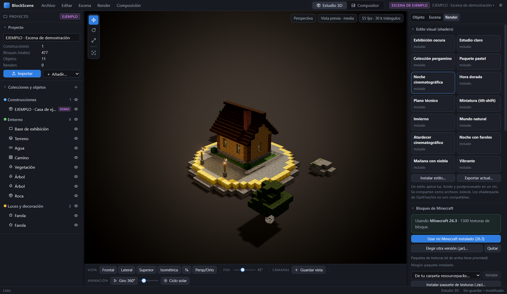
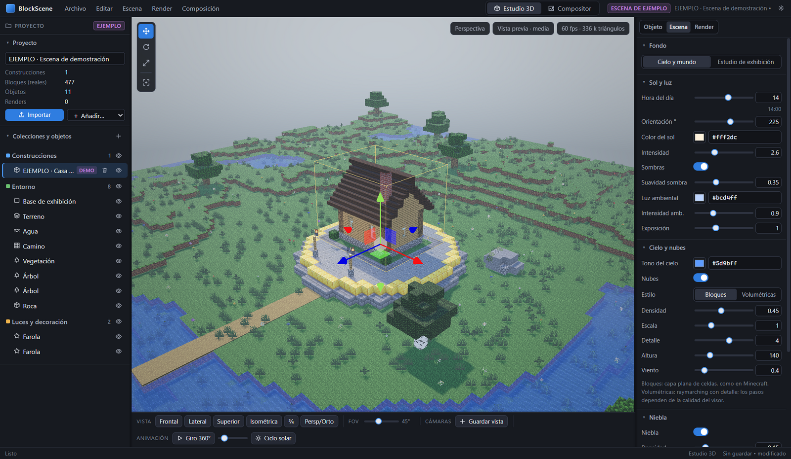

# Ambiente y estilos

## Estilos visuales (un clic)

En **Render → Estilo visual**, un estilo cambia de golpe la luz, el fondo, las nubes, la niebla y el postprocesado.

| Estilo | Aspecto |
|---|---|
| **Exhibición oscura** | Fondo de estudio oscuro con motas, sombra suave, brillo en las luces y viñeta |
| **Estudio claro** | Fondo gris claro de catálogo |
| **Colección pergamino** | Fondo beige liso, como las hojas de colección |
| **Paquete pastel** | Fondo azul pastel y sombras cortas, como los paquetes de casas |
| **Mundo natural** | Cielo de día con nubes de bloques |
| **Hora dorada** | Sol bajo y dorado con neblina, al estilo de los renders de paisaje |
| **Atardecer cinematográfico** | Luz cálida y neblina dorada |
| **Noche cinematográfica** y **Noche con faroles** | Ventanas y luces brillando |
| **Mañana con niebla**, **Invierno**, **Vibrante**, **Miniatura**, **Plano técnico** | Otros aspectos frecuentes en los renders de construcciones |

- **Instalar estilo…** carga archivos `.bslook`; también puedes arrastrarlos a la ventana.
- **Exportar actual…** guarda tus ajustes como estilo para compartirlos.

## Recetas como las de internet

| Aspecto | Base | Estilo | Render | Plantilla |
|---|---|---|---|---|
| Hoja de colección | Isla de terreno (seca) | Colección pergamino | Fondo transparente | Colección con etiquetas |
| Paquete de casas | Isla de terreno (verde) | Paquete pastel | Fondo transparente | Paquete de construcciones |
| Pieza destacada oscura | Escalonada o isla | Exhibición oscura | Normal | Exhibición |
| Escena nocturna | Terreno + agua | Noche cinematográfica + shader *Profundidad de campo* | Normal | Exhibición |

## Ajustes manuales (pestaña Escena)

- **Fondo**: *Cielo y mundo*, o *Estudio de exhibición*. El estudio tiene degradado, motas de polvo y un suelo invisible que solo recibe la sombra, y puede ocultar el terreno.
- **Sol y luz**: hora del día, orientación, color, intensidad, sombras y su suavidad, luz ambiental y exposición.
- **Cielo y nubes**: nubes de **bloques** (como en Minecraft) o **volumétricas**, con densidad, escala, detalle, altura y viento. El sol es cuadrado.
- **Niebla**: densidad, altura y color.
- **Clima**: despejado, lluvia o nieve, con intensidad.

## Postprocesado (pestaña Render)

Brillo (bloom), viñeta, saturación, contraste, calidez y grano. Se aplican igual en el visor y en el render final.
