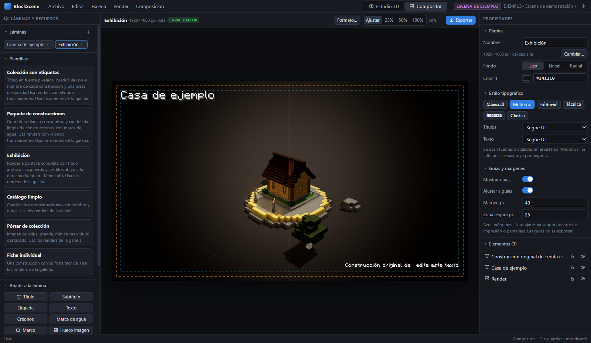
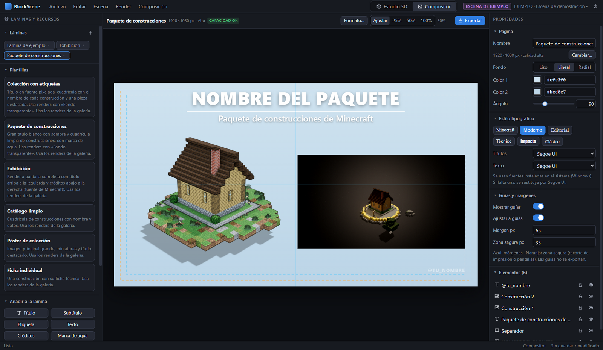
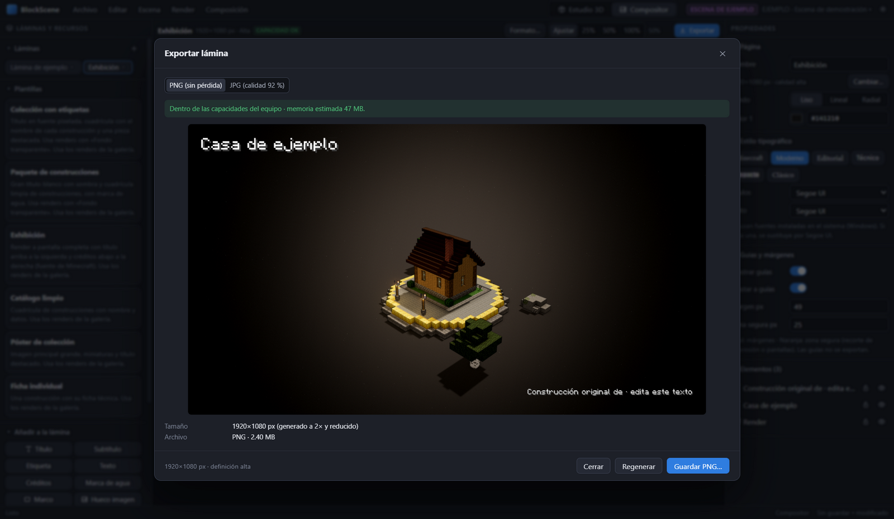

# Compositor

El **Compositor** (Ctrl+2) sirve para montar **láminas** con tus renders. El texto se añade aquí, después del render.

## Plantillas

| Plantilla | Uso |
|---|---|
| **Exhibición** | Render a pantalla completa, título arriba a la izquierda y créditos abajo a la derecha, en la fuente de Minecraft |
| **Colección con etiquetas** | Título pixelado, el nombre bajo cada construcción y una pieza destacada |
| **Paquete de construcciones** | Gran título con sombra, cuadrícula limpia y marca de agua |
| **Catálogo limpio**, **Póster de colección**, **Ficha individual** | La ficha se rellena con los datos reales del archivo |

Consejo: para *Colección* y *Paquete*, haz los renders con **Fondo transparente**. Así las construcciones aparecen recortadas sobre el fondo de la lámina.

## Editar la lámina

- **Arrastra** renders desde la galería a la página o a un hueco de imagen. Las imágenes de tu equipo también se pueden arrastrar.
- Mueve y redimensiona con el ratón (**Mayús** mantiene la proporción) o con las flechas del teclado.
- Puedes alinear, traer al frente o enviar al fondo, bloquear y ocultar.
- **Añadir a la lámina** tiene: título, subtítulo, etiqueta, texto, créditos, marca de agua, marco y hueco de imagen.
- **Fuente de Minecraft**: se lee de tu juego (con acentos) y se dibuja con su sombra.
- Otras opciones: guías, márgenes, zona segura, ajuste magnético, fondos liso, lineal o radial, y estilos tipográficos.
- **Guardar lámina actual como plantilla** te permite reutilizarla en otros proyectos.

## Formato y exportación

- **Formato…**: Full HD, 2K, 4K, cuadrado, 9:16, A4, A3, póster o **personalizado** (ancho y alto en píxeles), con definición rápida, alta o máxima. La app avisa si el tamaño supera lo que admite tu equipo.
- **Exportar** (Ctrl+E): primero genera la **vista previa** de la imagen final y después la guarda en **PNG o JPG** al tamaño exacto.

