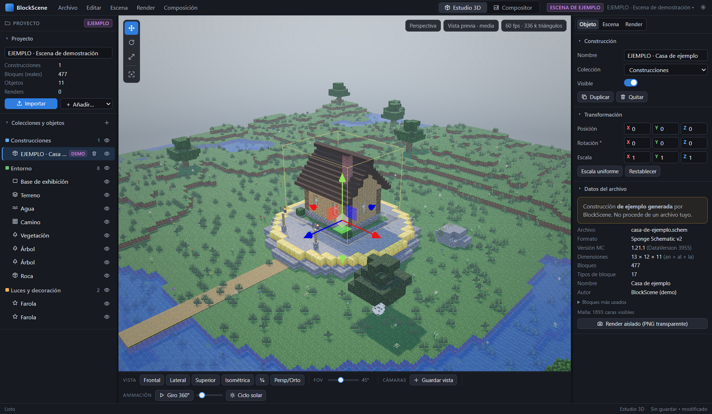
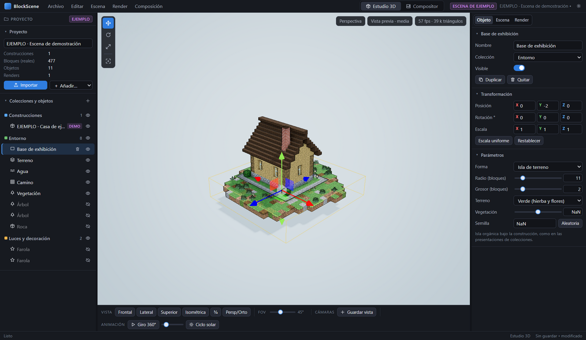

# Estudio 3D

## Objetos y colecciones

En el panel izquierdo, cada construcción o elemento es un objeto dentro de una **colección** (capa). Puedes ocultar colecciones enteras, renombrarlas con doble clic o crear nuevas con **+**.

## Mover, girar y escalar

- Usa las herramientas del visor o las teclas **G** (mover), **R** (girar) y **S** (escalar).
- Por defecto se mueve **de bloque en bloque** y se gira cada **15°**. Puedes cambiarlo en [[Preferencias y atajos|Preferencias-y-atajos]].
- Los valores exactos están en **Objeto → Transformación**.
- **Ctrl+D** duplica, **Supr** quita, **H** oculta, y **Ctrl+Z / Ctrl+Y** deshacen y rehacen.

## Elementos de escena (hechos de bloques)

Usa **＋ Añadir…** en el panel izquierdo o el menú **Escena**:

| Elemento | Detalle |
|---|---|
| **Base de exhibición** | Escalonada, redonda, cuadrada o **Isla de terreno** (verde, seca, nevada o arena) |
| **Terreno** | Colinas de bloques con hierba, flores y árboles |
| **Agua** | Bloques de agua; ponla un bloque por debajo del terreno para crear lagos |
| **Camino, roca, árbol** (9 especies) y **vegetación** | Elementos sueltos de bloques |
| **Luz** | Puntual o foco, con sombras opcionales |
| **Decoración** | Farola, valla, banco, hoguera, pozo y barriles |

## Cámaras y animación

- Vistas **Frontal, Lateral, Superior, Isométrica, ¾** y **Persp/Orto** (teclas 1, 3, 7, 9, 4 y 5).
- **Guardar vista** (Ctrl+K) crea cámaras reutilizables. La ⭐ marca la **cámara principal** del render.
- **Giro 360°** (Espacio) y **Ciclo solar** animan la escena.

## Guardar el proyecto

**Ctrl+S** guarda un archivo `.bscene` con tus construcciones, posiciones, cámaras, ajustes, renders y láminas.
