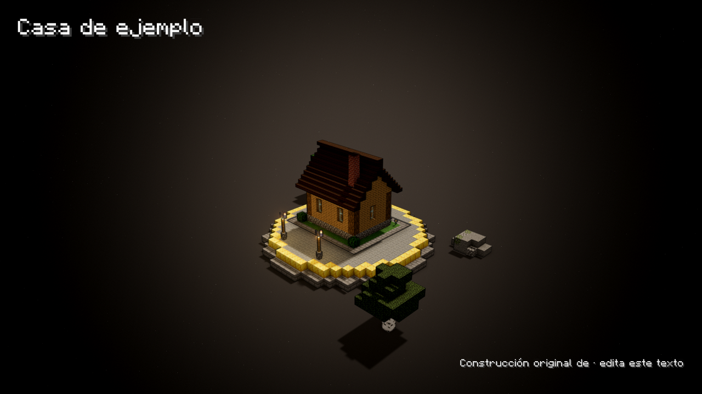

# BlockScene

**BlockScene** es una aplicación de escritorio gratuita para crear **escenas 3D y láminas de presentación** a partir de tus construcciones de Minecraft. Importas tus archivos `.schem`, `.litematic`, `.nbt`… y les das un entorno de bloques. Después eliges un estilo visual, haces el render y montas la lámina con título y créditos.

## Descargar

- ➡️ **[Descargar BlockScene para Windows](https://github.com/anthonylol12/BlockScene/releases/latest)**: archivo `BlockScene-Setup-x.y.z.exe`.
- 📘 **[Guía en PDF](https://github.com/anthonylol12/BlockScene/releases/latest)**: `BlockScene-Guia.pdf`, en la misma página.

## Contenido de esta wiki

1. [[Instalación]]
2. [[Primeros pasos|Primeros-pasos]]
3. [[Importar construcciones|Importar-construcciones]]
4. [[Texturas y paquetes|Texturas-y-paquetes]]
5. [[Estudio 3D|Estudio-3D]]
6. [[Ambiente y estilos|Ambiente-y-estilos]]
7. [[Shaders externos|Shaders-externos]]
8. [[Render]]
9. [[Compositor]]
10. [[Preferencias y atajos|Preferencias-y-atajos]]
11. [[Preguntas frecuentes|Preguntas-frecuentes]]

## Qué puedes hacer

| | |
|---|---|
| Importar varias construcciones a la vez y ver sus datos reales (formato, versión, dimensiones, bloques) | Usar las **texturas de tu Minecraft** y tus **paquetes de texturas** |
| Montar la escena con terreno, agua, árboles, islas de terreno y bases de exhibición hechas de bloques | Aplicar **estilos visuales** en un clic (exhibición oscura, pastel, hora dorada, noche…) |
| Añadir **shaders GLSL** propios (contorno, profundidad de campo…) | Hacer **renders** de alta calidad, también con fondo transparente |
| Diseñar **láminas** con plantillas, la fuente de Minecraft, guías y marca de agua | Exportar en **PNG o JPG** al tamaño exacto en píxeles |

> BlockScene no incluye texturas ni recursos de Minecraft: los lee de tu propia copia del juego. No está afiliado a Mojang ni a Microsoft.
