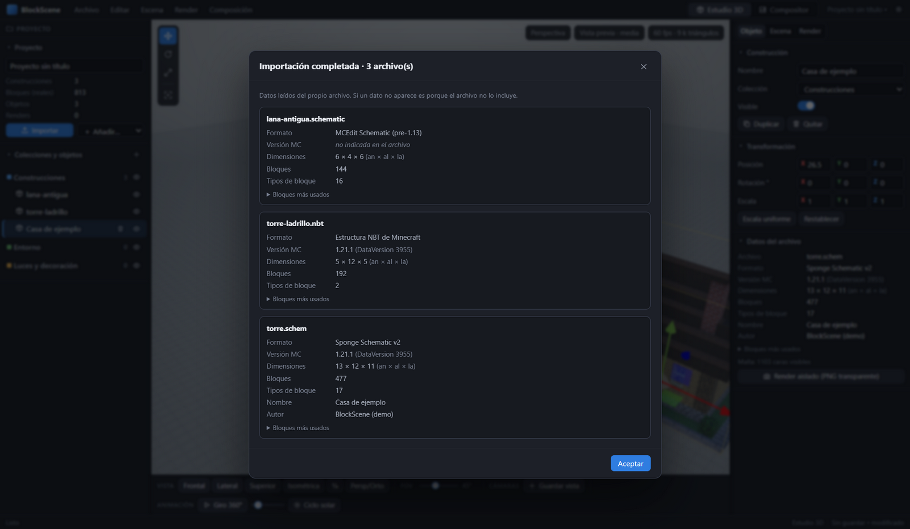

# Importar construcciones

Pulsa **Importar** (Ctrl+I) o **arrastra los archivos** a la ventana. Puedes importar varios a la vez: cada uno se convierte en un objeto independiente.

Tras importar verás un **informe con los datos leídos del propio archivo**: formato, versión de Minecraft, dimensiones, número de bloques, tipos de bloque, autor… Si un dato no aparece es porque el archivo no lo incluye.

## Formatos compatibles

| Extensión | Formato | Estado |
|---|---|---|
| `.schem` | Sponge Schematic v1, v2 y v3 (WorldEdit 7+, FAWE) | Completo |
| `.litematic` | Litematica (varias regiones) | Completo |
| `.nbt` | Estructura de Minecraft (Structure Block) | Completo |
| `.schematic` | MCEdit / WorldEdit clásico (anterior a 1.13) | Casi completo: respeta la orientación de escaleras, troncos, puertas, trampillas y antorchas |
| `.mca` | Región de mundo (Java 1.13+) | Parcial: se recorta al contenido |

- El formato se detecta por el **contenido**, no solo por la extensión.
- Si un archivo está dañado o no es compatible, la app explica el motivo y no lo importa.
- Límites: 120 millones de vóxeles por construcción y archivos de hasta 512 MB.

## Importar un mundo de Minecraft

Pulsa **Importar mundo…** en el visor vacío, *Archivo → Importar mundo de Minecraft…* o **Ctrl+Mayús+I**.

1. Elige un mundo de la lista (los de `.minecraft/saves`, del más reciente al más antiguo) o pulsa **Otra carpeta…** y busca la carpeta que contiene `level.dat`.
2. Verás su nombre, versión y punto de aparición, leídos de `level.dat`.
3. Elige la **dimensión** (mundo normal, Nether o End), el **centro** (punto de aparición o coordenadas X/Z, las mismas que muestra F3 en el juego), el **tamaño de la zona** (de 64×64 a 512×512 bloques) y la **altura** (Y mínima y máxima).
4. Pulsa **Importar zona**: la zona se convierte en una construcción más, guardada como `.schem` dentro del proyecto. El mundo original no se modifica.

- Se admiten mundos de Java 1.13 o posterior, tanto con la estructura clásica (`region`, `DIM-1`, `DIM1`) como con la de 26.x (`dimensions/minecraft/...`).
- Subir la altura mínima deja fuera cuevas y piedra subterránea: la escena va más rápida.
- Las zonas sin generar (nadie las ha explorado) no tienen archivos de región y se ignoran.

## Ver los datos más tarde

Selecciona la construcción y abre la pestaña **Objeto → Datos del archivo**.
