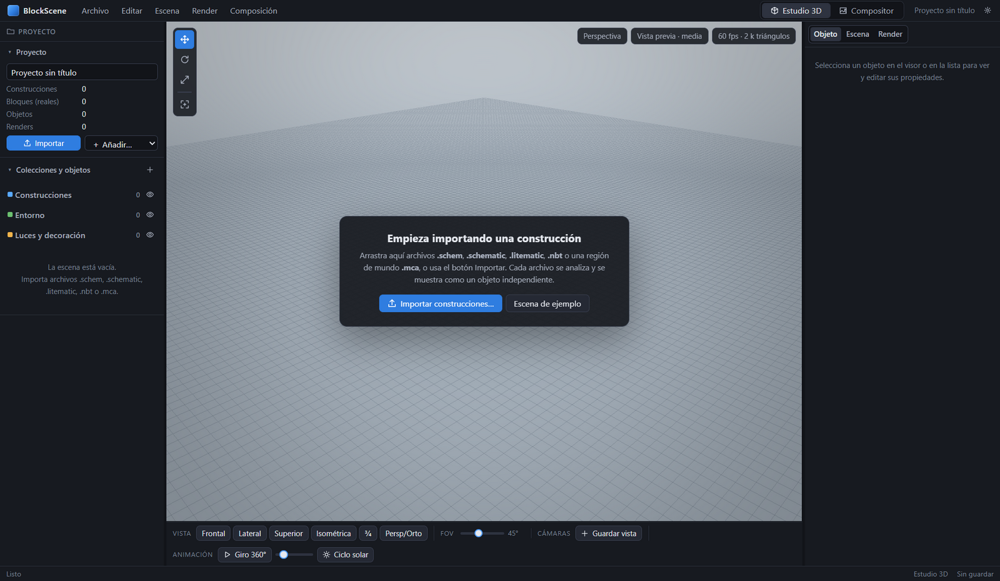

# Instalación

## Requisitos

- Windows 10 u 11 de 64 bits.
- Tarjeta gráfica con WebGL 2 (cualquier GPU de los últimos años) y la aceleración por hardware activada.
- Recomendado: **Minecraft Java Edition** instalado, para usar las texturas reales de los bloques.

## Instalar

1. Ve a **[Releases](https://github.com/anthonylol12/BlockScene/releases/latest)** y descarga `BlockScene-Setup-x.y.z.exe`.
2. Ábrelo. Si Windows muestra **«Windows protegió su PC»**, pulsa **Más información → Ejecutar de todas formas**. Aparece porque el instalador no está firmado digitalmente, algo habitual en proyectos gratuitos.
3. Elige la carpeta y termina. No necesita permisos de administrador.
4. Abre BlockScene desde el acceso directo del **escritorio** o del **menú Inicio**.

El instalador también asocia los proyectos `.bscene`: con doble clic se abren en BlockScene.



## Actualizar

Descarga el instalador de la nueva versión y ejecútalo. Reemplaza la versión anterior y conserva tus ajustes, paquetes, estilos y shaders.

## Desinstalar

*Configuración → Aplicaciones → BlockScene → Desinstalar.* Tus proyectos `.bscene` no se borran.

## Compilar desde el código (desarrolladores)

```bash
git clone https://github.com/anthonylol12/BlockScene.git
cd BlockScene
npm install
npm run dev      # ejecutar en modo desarrollo
npm run dist     # crear el instalador en dist/
```

Necesitas Node.js 20 o superior.
