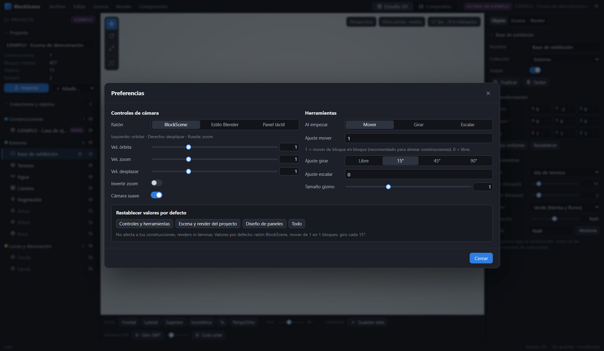

# Preferencias y atajos

Abre **Editar → Preferencias…** (Ctrl+,) o el **engranaje** de la barra superior.

- **Ratón**:
  - *BlockScene*: izquierdo orbita, derecho desplaza.
  - *Estilo Blender*: la rueda pulsada orbita y Mayús + rueda pulsada desplaza.
  - *Panel táctil*.
  - Además: velocidades, zoom invertido y cámara suave.
- **Herramientas**: la herramienta inicial, el ajuste al mover (1 = de bloque en bloque), el ajuste al girar (15°, 45° o 90°), el ajuste al escalar y el tamaño del gizmo.
- **Restablecer valores por defecto**: controles y herramientas, escena y render del proyecto, diseño de paneles, o todo a la vez. No toca tus construcciones, renders ni láminas.

## Atajos de teclado

| Atajo | Acción |
|---|---|
| Ctrl+N / Ctrl+O / Ctrl+S | Nuevo / abrir / guardar proyecto |
| Ctrl+I | Importar construcciones |
| Ctrl+Mayús+I | Importar un mundo de Minecraft |
| Ctrl+Z / Ctrl+Y | Deshacer / rehacer |
| Ctrl+D / Supr / H | Duplicar / quitar / ocultar |
| G / R / S | Mover / girar / escalar |
| F | Encuadrar la selección |
| 1 / 3 / 7 / 9 / 4 / 5 | Frontal / lateral / superior / isométrica / ¾ / perspectiva-ortográfica |
| Ctrl+K | Guardar la vista de cámara |
| Espacio | Giro 360° |
| F12 | Render final |
| Ctrl+Mayús+F12 | Exportar vídeo o GIF |
| Ctrl+1 / Ctrl+2 | Estudio 3D / Compositor |
| Ctrl+E | Exportar lámina |
| Ctrl+, | Preferencias |
| F1 | Lista de atajos |
