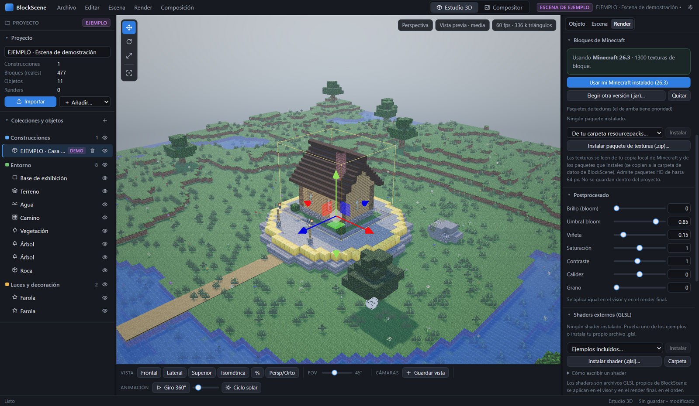
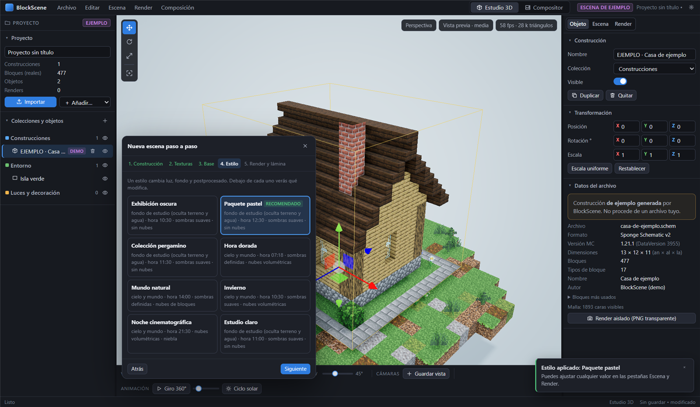

# Primeros pasos

## La ventana

| Zona | Para qué sirve |
|---|---|
| **Barra superior** | Menús Archivo, Editar, Escena, Render y Composición. Cambio entre **Estudio 3D** y **Compositor**. Engranaje de preferencias |
| **Panel izquierdo** | Proyecto, colecciones (capas) y objetos: seleccionar, ocultar (👁) y quitar |
| **Visor 3D** (centro) | La escena. Herramientas de mover, girar y escalar arriba a la izquierda |
| **Panel derecho** | Pestañas **Objeto** (propiedades), **Escena** (fondo, luz, cielo, niebla y clima) y **Render** (estilos, texturas, postprocesado, shaders y calidad) |
| **Barra inferior** | Vistas de cámara, cámaras guardadas y animación |

## Tu primera escena con el asistente (recomendado)

Pulsa **Crear escena paso a paso** en el visor vacío, *Archivo → Nueva escena paso a paso…* o **Ctrl+Mayús+N**. El asistente es un panel que flota sobre el visor, así que ves cada cambio en directo:

1. **Construcción**: elige tu archivo (o la casa de ejemplo). Verás sus datos reales (formato, versión, dimensiones, bloques) antes de continuar. Si el archivo está dañado o no es compatible, el motivo aparece en el mismo panel.
2. **Texturas**: usa las de tu Minecraft instalado o sigue sin ellas.
3. **Base**: isla verde, seca, nevada o de arena, base de exhibición o sin base. Se ajusta sola al tamaño de la construcción.
4. **Estilo**: cada opción indica **qué cambia** (fondo, hora, nubes, brillo, viñeta…) y se marca el **recomendado** para la base elegida.
5. **Render y lámina**: elige la presentación (Exhibición, Paquete, Colección o Ficha; se recomienda una según el estilo), el encuadre y la calidad. **Renderizar y crear lámina** hace el render con el fondo adecuado y abre la lámina en el Compositor.

Puedes cerrar el asistente en cualquier momento: lo que hayas hecho se conserva.

## Tu primera escena a mano

1. **Prueba la escena de ejemplo**: en el visor vacío pulsa **Escena de ejemplo** (o *Archivo → Cargar escena de demostración*). Está marcada como *EJEMPLO*.
2. **Activa las texturas de Minecraft**: pestaña **Render → Bloques de Minecraft → Usar mi Minecraft instalado**.
3. **Elige un estilo**: en **Render → Estilo visual** pulsa, por ejemplo, *Exhibición oscura*.
4. **Encuadra**: botón **¾** de la barra inferior (o tecla 4).
5. **Renderiza**: **F12 → Render final**.
6. **Monta la lámina**: pestaña **Compositor → plantilla Exhibición**. Edita el título y pulsa **Exportar**.

## Mover la cámara

| Ratón (por defecto) | Acción |
|---|---|
| Botón izquierdo + arrastrar | Orbitar |
| Botón derecho + arrastrar | Desplazar |
| Rueda | Acercar o alejar |
| Clic | Seleccionar un objeto |

Puedes cambiar a controles **estilo Blender** o **panel táctil** en [[Preferencias y atajos|Preferencias-y-atajos]].
