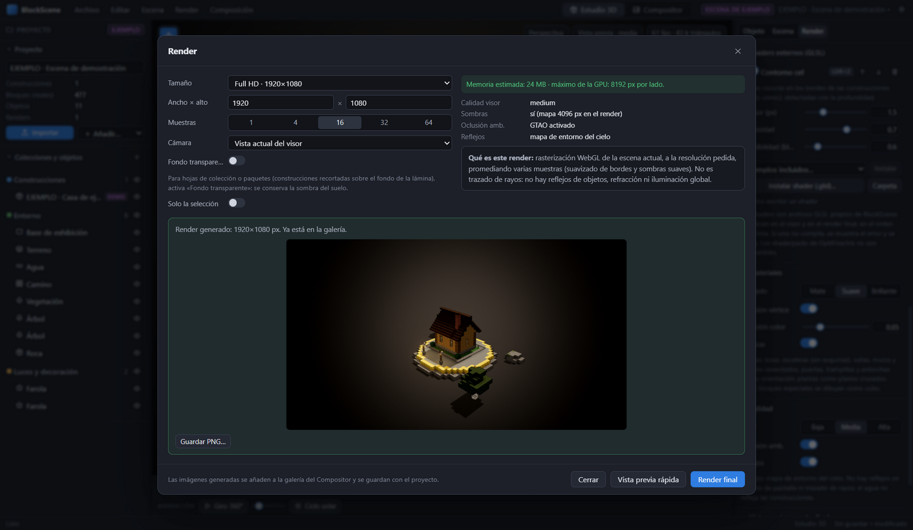

# Render

Pulsa **F12** (o el menú **Render → Render final…**).

| Opción | Para qué sirve |
|---|---|
| **Tamaño** | Predefinidos (HD, Full HD, 2K, 4K, cuadrado, vertical) o personalizado |
| **Muestras** | 1 a 64. Más muestras dan bordes y sombras más suaves; 16 es un buen equilibrio |
| **Cámara** | La vista actual o una cámara guardada (por defecto, la principal ⭐) |
| **Fondo transparente** | PNG sin fondo que conserva la sombra del suelo. Se recorta solo al contenido |
| **Solo la selección** | Renderiza únicamente la construcción seleccionada |

- **Vista previa rápida** hace una imagen de 1 muestra y hasta 960 px de ancho.
- **Render final** usa el tamaño y las muestras elegidos.

Cada render se añade a la **galería del Compositor** y se guarda con el proyecto. Puedes guardarlo como PNG con **Guardar PNG…**.

**Añadir a lámina**: al terminar un render (y también al abrirlo desde la galería), elige una plantilla y pulsa **Añadir a lámina**. Se crea una lámina con ese render como pieza principal y se abre el Compositor. Si el render tiene fondo transparente se propone *Paquete de construcciones*; si no, *Exhibición*.

También tienes **Render aislado (PNG transparente)** en *Objeto → Datos del archivo*: renderiza una sola construcción con fondo transparente.

> El render es por rasterización (WebGL), no por trazado de rayos. El agua refleja el cielo, no las construcciones. La app avisa si el tamaño pedido supera lo que admite tu tarjeta gráfica.
