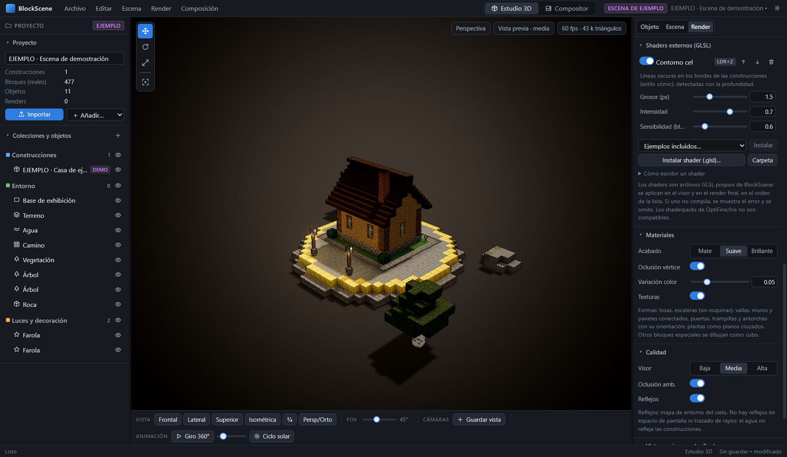

# Shaders externos (GLSL)

En **Render → Shaders externos** puedes añadir **efectos GLSL propios** que se aplican en el visor y en el render final, en el orden de la lista.



## Ejemplos incluidos

- Contorno cel
- Profundidad de campo
- Aberración cromática
- Cine teal y naranja
- Nitidez

Elígelos en **Ejemplos incluidos… → Instalar**. Despliega un shader para ajustar sus parámetros con los deslizadores.

## Instalar tus shaders

- Pulsa **Instalar shader (.glsl)…** o **arrastra el archivo** a la ventana.
- **Carpeta** abre la carpeta donde se guardan.
- Si un shader tiene un error, se muestra el mensaje de GLSL con la línea y ese shader se omite, sin romper el render.

> Los **shaderpacks de OptiFine/Iris** no son compatibles: están escritos para el motor gráfico de Minecraft. Si arrastras uno, la app lo detecta y te lo explica.

## Escribir un shader

```glsl
// @name Mi efecto
// @description Texto de ayuda
// @stage ldr          // ldr: después del tono (sRGB) · hdr: antes (lineal)
// @depth              // opcional: activa la textura de profundidad tDepth
// @param fuerza 0.5 0 1 Fuerza   // nombre  defecto  mín  máx  etiqueta
uniform sampler2D tDiffuse;   // la imagen
uniform sampler2D tDepth;     // profundidad 0..1 (con @depth)
uniform vec2 uResolution;     // tamaño en píxeles
uniform float uTime, uNear, uFar;
uniform float fuerza;         // cada @param es un uniform float
varying vec2 vUv;

void main() {
  vec4 c = texture2D(tDiffuse, vUv);
  gl_FragColor = vec4(c.rgb * (1.0 - fuerza * 0.5), c.a);
}
```

Para convertir la profundidad en distancia (en bloques):

```glsl
float lin(vec2 uv) {
  float z = texture2D(tDepth, uv).x * 2.0 - 1.0;
  return (2.0 * uNear * uFar) / (uFar + uNear - z * (uFar - uNear));
}
```

Los ejemplos incluidos están en [src/renderer/src/shaders/examples](https://github.com/anthonylol12/BlockScene/tree/main/src/renderer/src/shaders/examples).
